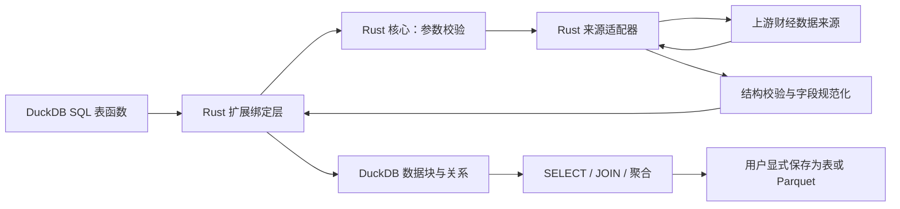

# 架构

状态：**已实现并验证 (v0.1.0)**。架构基于 DuckDB Unstable C API 与 Rust 2024 实现，包含 core、eastmoney 和 bindings 模块，各层职责与安全边界已由 G1–G3 门禁完整验证。
## 总体数据流



Rust 核心处理数据获取与规范化，扩展绑定层处理 DuckDB 生命周期和输出。核心测试不需要启动 DuckDB；首版不额外建设 Python 包或 HTTP 服务。

`aki_stock_daily` 接收显式来源，绑定阶段验证来源是否受支持；数据经单位确认后输出固定 schema。另一个入口 `aki_datasets()` 仅返回当前版本已实现的数据集与来源目录，不调用网络，也不探测来源健康状态。

## 最少职责划分

| 部分 | 负责 | 边界 |
| --- | --- | --- |
| Rust 请求与数据类型 | 日期范围、支持市场、规范化记录和错误结果 | 不引用 DuckDB 的连接、向量或数据块类型 |
| Rust 来源适配器 | 上游代码映射、请求、分页、响应解释、单位确认 | 第一版只有一个具名来源，不搭建插件框架 |
| Rust 规范化逻辑 | 类型、必需字段、NULL、日期过滤、重复键、来源与时间标签 | 不计算策略、补行情或默默纠正可疑数值 |
| DuckDB 绑定层 | SQL 参数转换、schema、扫描状态、记录到数据块的转换 | 不隐式创建持久表或写用户文件，不重复实现来源解析 |

这些是职责边界，不要求每项各建一个 crate 或抽象 trait。首版可用一个 crate 内的模块隔离核心与绑定；是否拆为 workspace、单独发布 Rust 库，等有实际复用需求再定。

目录与读取入口复用同一份已实现能力声明，避免两处维护来源列表。首版用静态定义即可，不引入动态 provider 注册或插件系统。

## 扩展执行约定

DuckDB 提供表函数的 bind、init 和扫描相关 C API；Rust 绑定与模板能力以选定版本为准。[DuckDB Table Functions](https://duckdb.org/docs/current/clients/c/table_functions)

读取接口遵守以下行为，具体绑定能力在原型中验证：

1. **绑定**：检查参数并声明固定 schema；不访问网络。普通 `EXPLAIN`、`DESCRIBE` 不应抓取行情；`EXPLAIN ANALYZE` 属于实际执行。
2. **初始化/首次扫描**：为该扫描创建独立请求状态，获取有界的单标的日期范围，完整校验后准备输出。
3. **扫描**：将已校验结果按 DuckDB 数据块大小交付；不在每个输出块里重新抓取同一段行情。
4. **结束/取消**：释放响应、缓冲区及请求资源；网络超时给阻塞等待设置上限，取消能力须验证。

首版可以缓冲一个受大小与行数限制的完整结果，以便在输出前发现坏行和分页中断。超过上限明确失败；更大范围的流式处理在出现实际需求后再设计。

请求状态不存放在可变全局单例。重扫描、重复函数引用或不同查询可能重新访问上游；不承诺 SQL 文本里写一次函数就永远只发一次请求。要求稳定快照时先显式物化再重复查询。

日期参数用于缩小上游请求并在本地复核。一般 `WHERE` 谓词下推、投影下推、并行跨标的抓取均不属于首版承诺。

`LIMIT` 限制 SQL 输出行数，不保证限制来源返回的数据量。普通视图保存查询定义，不提供远程快照；重复分析使用显式临时表，跨会话使用持久表或 Parquet。

## Rust 与宿主边界

核心以普通 Rust 类型接收请求、返回记录及可解释的错误；输入解析、来源异常等使用 `Result` 传播。DuckDB 类型转换集中在绑定层，不把 C API 指针带入来源逻辑。

FFI 回调要按所用绑定的约定处理错误和 panic，不能让 Rust unwind 越过 C ABI；绑定层同时负责缓冲区与字符串的所有权。避免在来源响应解析路径使用 `unwrap`/`expect` 把坏数据升级为宿主崩溃。

第一版建议采用有界同步获取，不先引入后台任务或长期 async runtime；若模板或依赖确实要求异步，再明确运行时、线程和取消的所有权。Python AKShare 只作为对照样本工具，不参与运行时数据流。

## 持久化与数据边界

默认只返回数据，不写本地数据库、不自动建缓存。用户显式决定文件路径、覆盖和追加策略。以下为已验证可执行的扩展用法：

```sql
CREATE TEMP TABLE prices AS
SELECT * FROM aki_stock_daily(
    'sz000001', DATE '2024-01-01', DATE '2024-02-01',
    source = 'eastmoney'
);

COPY prices TO 'prices.parquet' (FORMAT PARQUET);
```

同一日期的历史数据可能在来源端修订。不同 `fetched_at` 的保存结果是不同观测批次；首版不负责增量 upsert、历史版本管理或时点数据保证。

## 网络与错误边界

- 只请求适配器定义的来源地址，不提供任意 URL 代理或用户 SQL 拼接入口；查询参数通过结构化编码传递。
- 请求来源由必填的 `source` 决定，失败不自动切源。字段中的 `source` 记录实际提供方；规范化输出股数、金额及币种，不将 AKShare 记作行情提供方。
- 认证、TLS、超时、响应体限制和分页上限不能因减少代码而省略；不关闭证书校验。
- 原生网络实现须遵守目标 DuckDB 的外部访问限制；若所选 HTTP 库绕过了引擎限制，必须显式检查并测试。
- 仅对已确认可重试的临时错误做有界重试；拒绝访问或结构变化应暴露原因，不循环轰炸来源。
- 对外错误说明阶段、来源和必要上下文，不泄露凭据或整段敏感响应。将错误传播到查询边界，不伪造零行成功。

## 测试边界

核心回归依赖来源响应 fixture，覆盖解析和规范化；DuckDB 集成验证类型与 SQL 行为；可控本地响应验证超时、错误和分页。真实网络冒烟单独运行，用于发现来源漂移，不能替代离线测试或阻断所有普通开发。

未来若增加新来源，应先证明其字段和单位符合现有合同；口径不同则显式区分，不在同名列下悄悄混合。
