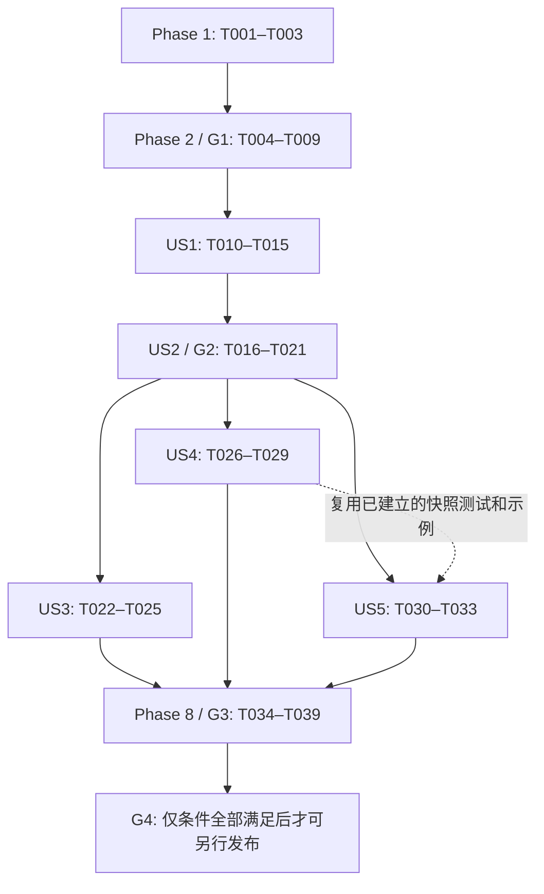

# Tasks: 财经数据获取与分析

**Input**: `specs/001-financial-data-access/` 下的 [spec.md](spec.md)、[plan.md](plan.md)、[research.md](research.md)、[data-model.md](data-model.md)、[SQL 合同](contracts/sql.md)、[来源合同](contracts/eastmoney.md)和 [quickstart.md](quickstart.md)。

**Context**: 当前 Git 分支 `master`，尚无提交或源码工程；本文件仅生成待办，不执行实现。技术路线沿用一个 Rust crate、DuckDB 原生扩展、两个表函数、显式 eastmoney、首个标的 sz000001、不复权日线、最多 366 自然日。

**Tests**: 纳入测试任务，因为 spec 的 User Scenarios & Testing 明确要求各故事的 Independent Test，SC-002–SC-006 明确要求受控样本、故障与离线回归，SC-007 要求真实读取证据。各故事先写能暴露目标行为缺失的断言，确认失败原因，再实现并验证；不要求为文档改字增加测试。constitution 仍是未采纳模板，不由本次补定治理规则或审批。

**Format**: `- [ ] Tnnn [P?] [USn?] 具体动作与仓库相对文件路径`。`[P]` 只表示其明确前置完成后，可与本节指定的不同文件任务并行，不表示跳过依赖。未标 `[P]` 的共享文件任务串行。

## Phase 1: Setup — 固定工程基线

**目标**：引入固定模板所需文件，锁定唯一的初始构建组合，不覆盖已有文档、不新建多 crate workspace。

- [X] T001 从官方 Rust 模板 commit `abb7b2f3f954a47f90fc37a99cda3ce0618e6094` 选择性引入 `Makefile`、`Cargo.toml`、`src/lib.rs`、`.gitmodules` 和必要打包配置，将扩展改名 duckaki、移除模板示例函数，固定 `extension-ci-tools/` 子模块为 `a285602bf745d6ceaa704b5df47f08b00ca296ae`，保留上游归属声明且不擅自选择项目许可证。
- [X] T002 [P] 在 `rust-toolchain.toml` 固定 Rust 1.92.0，在 `Cargo.toml` 固定 edition 2024、`duckdb = "=1.10505.0"` 的 loadable-extension、`ureq = "=3.4.2"` / Rustls、serde 1、serde_json 1、chrono 0.4，声明默认关闭的 test-support 并保持 panic=unwind，生成 `Cargo.lock`，不加入异步运行时或通用 provider 依赖（依赖：T001）。
- [X] T003 [P] 在模板测试依赖文件 `test/requirements.txt` 固定测试 Python DuckDB 1.5.5并复用模板 SQLLogicTest 工具，在 `.gitignore` 排除构建产物、虚拟环境和验证数据库；保留现有忽略规则，测试数据放 `tests/fixtures/`，不提交真实行情（依赖：T001；可与 T002 并行）。

**检查点**：模板和子模块可追溯，目标 CLI 精确为 1.5.5；尚不宣称本机已构建成功。

## Phase 2: Foundational — 共享类型、测试入口与宿主关卡 G1

**目标**：所有故事共用的请求/状态/错误边界与原生绑定先可验证；这一阶段阻塞故事实现。固定数据仅是测试构建中的工程探针，不登记成普通构建的已支持来源。

- [X] T004 [P] 在 `src/core.rs` 建立 DailyRequest、DailyRecord、FetchBatch、Capability 和稳定错误类别的普通 Rust 类型及静态能力定义，正常构建初始已交付清单为空；以小型单测先约束必填 source/symbol、精确 sz000001、有限合法日期、两端包含、同日/366 天合法和 367 天超限，保证核心不引用 DuckDB 类型（依赖：Phase 1）。
- [X] T005 [P] 在 `tests/integration/test_sql.py` 建立 unittest 驱动、临时 loopback HTTP server、计数/墙钟/新连接及进程清理；先加入 G1 的原生加载、无网络 bind、外部访问关闭、PREPARE 后禁用、在途 interrupt、panic 后宿主可用断言，并在 `tests/fixtures/g1-response.json` 构造最小非真实响应（依赖：Phase 1；可与 T004 并行）。
- [X] T006 在 `src/eastmoney.rs` 实现来源内部的同步 HTTP 获取和有界正文读取，使用已有 core 错误类型：生产固定 HTTPS 地址且校验证书、总 deadline 30 秒、DNS/连接各 5 秒并受剩余预算约束、头 32 KiB/解码正文 1 MiB 上限、非 2xx 拒绝、无应用层重试/重定向/分页；test-support 的 endpoint 覆盖只接受 loopback，普通构建不编入覆盖入口（依赖：T004、T005）。
- [X] T007 在 `src/bindings.rs` 和 `src/lib.rs` 完成两个表函数的最小 C API 注册与固定 schema、DATE/NULL/字符串转换和 TIMESTAMPTZ 写入、扫描独立状态与 max_threads=1；通过 bind context 读取并在执行前复查 enable_external_access，按返回状态/类型/NULL 默认拒绝；为 context/value/记录状态设置唯一释放责任，bind/init/scan 捕获 panic、析构不 panic；测试构建暂用固定批次走 T006 验证在途等待，普通目录保持空（依赖：T004–T006）。
- [X] T008 在 `Makefile` 接通 configure/debug 与带 footer 的 duckaki 产物，Cargo 构建按锁文件运行；新增唯一的 test_offline 目标，隔离 test-support 与正常产物，复用模板 SQLLogicTest 执行 `test/sql/host.test`，并驱动 `tests/integration/test_sql.py` 和 Rust 单测，失败传播非零状态（依赖：T005、T007）。
- [X] T009 执行固定版本的 configure/debug、CLI 原生加载和 G1 回归，在 `docs/validation/g1-engine.md` 记录版本/平台/命令及实际结果；证明 DATE/TIMESTAMPTZ/NULL、零请求 bind、PREPARE 设置变化、请求中 interrupt 最终失败、剩余 30 秒预算、重复成功/空批次/失败/panic 的释放和宿主可继续使用；任何不通过先修 `src/bindings.rs` / `src/eastmoney.rs` 最小根因，不进入真实来源交付（依赖：T008）。

**检查点 G1**：先通过测试探针证明工程/宿主边界，再进入真实数据解析。临时固定批次探针由 T014 替换，不保留第二套产品读取逻辑。此时不以 fixture 成功宣称 eastmoney 已交付。

## Phase 3: User Story 1 — 获取一个标的的可追溯历史日线（P1）

**Goal**：一个有界完整批次按固定 12 列返回，单位、日期、NULL、来源与获取时间可追溯。

**Independent Test**：对合成已知区间逐列比较原生表函数结果，包含已知交易日、周末、区间外有效行、单日和前导零；字段/换算全部一致，不要求目录先显示来源。来源登记与公开成功声明等待 US2/G2。

### Tests first

- [X] T010 [P] [US1] 在 `tests/fixtures/stock_daily.json`、`tests/fixtures/expected_daily.json` 构造 11 字段原始行和已知期望，在 `src/core.rs` / `src/eastmoney.rs` 添加单位、区间、必需字段及批内唯一性单测；来源缺失标记未确认时拒绝空串/横线，另以内部可选值样本验证 NULL 不变零，不伪造原站格式（依赖：T009）。
- [X] T011 [P] [US1] 在 `test/sql/stock_daily.test` 先加入 12 列顺序/类型、带市场前导零、两端包含、有效范围外过滤、不补周末、CNY/eastmoney/none 和批内统一 fetched_at 的 SQL 合同断言（依赖：T009；可与 T010 并行）。
- [X] T012 [US1] 在 `src/core.rs` 完成标准记录与整批规范化：检查必需值和有限数值、可选量额、批内键唯一、日期过滤、最终 366 行上限；一次完整校验后生成统一 fetched_at，失败不返回部分批次，不引入持久批次表或全局缓存（依赖：T010）。
- [X] T013 [US1] 在 `src/eastmoney.rs` 完成 secid=0.000001、beg/end、klt=101、fqt=0 和 fields 参数编码及响应解析；校验 rc=0、data/code/market/klines 和 11 字段位置，成交手数精确十进制乘 100 后检查非整数/负数/BIGINT 溢出，金额保持元，合法空数组返回空批次，可见截断/续页要求失败（依赖：T010、T012）。
- [X] T014 [US1] 在 `src/bindings.rs` 将工程固定批次探针替换为 T006/T013 的同一获取解析路径，按扫描状态只抓取一次、全批通过后按实际数据块容量输出并正确置 NULL bitmap；用绑定内的内部记录测试验证可选 NULL 向量写入，不公开 fixture 来源、不放宽原站缺失标记规则（依赖：T011–T013）。
- [X] T015 [US1] 运行已知样本的 Rust/原生 SQL 回归，在 `docs/validation/us1-daily.md` 逐列记录日期、OHLC、股数换算、金额币种、可选 NULL 写入、批内时间及无重复/无补行结果；区分测试产物和普通构建，确认 `src/bindings.rs` 不再有绕过解析的临时固定批次返回路径（依赖：T014）。

**检查点**：US1 可独立用已知样本验收；这是日线核心增量，尚不能单独视为可交付 MVP，因为 spec 要求失败分辨与成功读取一起交付。

## Phase 4: User Story 2 — 分辨无数据与读取失败（P1）

**Goal**：完整覆盖错误分类、合法空结果、有界终止、取消和不切源；取得真实来源接入关卡 G2 证据。

**Independent Test**：在不依赖公网的条件下，八类 SC-004 情形全部呈现合同状态，非法输入零请求，空结果 schema 不变，失败无部分成功记录；安全/取消仍通过 G1。真实来源核验单独执行。

### Tests first

- [X] T016 [P] [US2] 在 `tests/fixtures/source-errors.json`、`src/core.rs` / `src/eastmoney.rs` 单测及 `test/sql/stock_daily.test` 添加参数缺失/NULL/空/未支持、DATE infinity/倒置、rc/身份/结构损坏、data=null、坏值/非有限值/溢出、相同重复键、范围外坏行和合法空数组回归，核对允许值提示及零请求条件（依赖：T015）。
- [X] T017 [P] [US2] 在 `tests/integration/test_sql.py` 扩展 HTTP 403/429/3xx、连接/TLS 失败、慢 headers/body 与滴流、正文断开、可见截断、头/解码正文/行数超限的故障注入，检查墙钟预算、无应用层重试/切源、错误脱敏和无部分成功；复用 G1 的三个取消时点与 PREPARE 检查，不用 kill 进程冒充取消（依赖：T015；可与 T016 并行）。
- [X] T018 [US2] 在 `src/core.rs`、`src/eastmoney.rs`、`src/bindings.rs` 集中完成和校正 T016/T017 揭示的错误传播根因，按 SQL 合同保留 INVALID_ARGUMENT、EXTERNAL_ACCESS_DISABLED、SOURCE_ACCESS、SOURCE_DATA、LIMIT_EXCEEDED、INTERNAL 与宿主中断区别；deadline 覆盖读取/校验和输出前检查，失败后释放状态且不能继续输出，禁止用空表吞错；运行 T016/T017 的全部断言并通过后才能继续 G2 核验（依赖：T016、T017）。
- [X] T019 [US2] 在 `src/eastmoney.rs` 添加默认 ignored、仅显式执行的最小 Rust 来源核验测试，清除测试 endpoint 覆盖并使用真实 HTTPS，读取 sz000001 的 2024 全年、一个单日和已知周末；在 `docs/validation/g2-source.md` 记录 Rust HTTP/TLS、响应边界/单位依据、访问和使用条件核对、时间与参数摘要，不提交原始行情，不将先前 curl 探测替代此次证据；无法满足来源条件时记录 G2 阻断，不换源（依赖：T018）。
- [X] T020 [US2] 仅在 T009、T018 和 T019 通过后，在 `src/core.rs` 的同一静态能力定义中将 stock_daily/eastmoney/sz000001 纳入普通构建支持范围，完成普通产物下的读取与空结果核验；在 `tests/live/smoke.sql` 写显式日线冒烟入口并将 SQL 查询/版本/参数/结果摘要补入 `docs/validation/g2-source.md`，不增加运行时健康探测或自动来源审批配置（依赖：T019）。
- [X] T021 [US2] 执行 `Makefile` 的 test_offline 及普通原生产物验收，在 `docs/validation/us2-errors.md` 逐项列出 SC-004 八类状态及扩展限额/取消/外部访问结果，确认 G1 无回归、G2 有 Rust 与 SQL 真实来源证据、读取无自动落盘；不把测试 fixture 成功标为 live 成功（依赖：T020）。

**检查点 G2 / 最小可交付读取增量**：US1 + US2。来源不满足 G2 时保留离线结果，停止来源交付及目录登记，不伪造“任务全部完成”。

## Phase 5: User Story 3 — 离线了解已支持的数据集与来源（P2）

**Goal**：目录从真实交付清单返回四列关系，离线可查、不探测来源健康。

**Independent Test**：公网断开连续查五次，每次 <2 秒、内容与读取支持清单相等、请求数为 0；外部访问关闭及来源暂时离线时仍可查，无未来项。

### Tests first

- [X] T022 [P] [US3] 在 `test/sql/datasets.test` 添加四列 schema、每组合一行、仅 stock_daily/eastmoney、description 含 sz000001/不复权/366 自然日、空清单形状和不包含未来能力的合同测试（依赖：T021）。
- [X] T023 [P] [US3] 在 `tests/integration/test_sql.py` 添加关闭公网/来源离线/enable_external_access=false 的目录查询，连续五次独立计时并核对网络计数为 0，逐项比较目录与读取实际允许值（依赖：T021；可与 T022 并行）。

### Implementation

- [X] T024 [US3] 在 `src/bindings.rs` 完成 aki_datasets 的静态扫描，直接消费 `src/core.rs` 已交付能力定义，零行也保留四列；不复制另一份来源列表、不读取网络健康、不让日线的外部访问检查阻止离线目录（依赖：T022、T023）。
- [X] T025 [US3] 运行目录合同与离线计时验收，在 `docs/validation/us3-datasets.md` 记录五次耗时、零请求及清单对照，在 `README.md` 更新已验证的发现示例与精确范围，保持未经验证的平台/安装方式为未支持（依赖：T024）。

## Phase 6: User Story 4 — 关联和聚合一次获取的结果（P2）

**Goal**：通过 DuckDB 原生 SQL 关联、汇总并显式物化同批数据；不新增产品层保存或聚合代码。

**Independent Test**：已知三行快照与 watchlist JOIN 得三行，按月/币种汇总为 12000 和 22000；断开来源后重复分析三次，请求计数不增加，默认读取不建缓存/持久表。

### Tests first

- [X] T026 [P] [US4] 在 `test/sql/snapshots.test` 用 quickstart 的合成快照验证 symbol JOIN、按月份和币种 SUM、NULL 语义、显式临时 CTAS 和 ORDER BY；期望结果从已知输入独立写出，不把合成 NULL 字符串伪装成原站格式（依赖：T015、T021；不依赖目录实现）。
- [X] T027 [P] [US4] 在 `tests/integration/test_sql.py` 验证一次读取后显式临时表保留同批元数据、断开来源重查三次为零新请求，比较只读查询前后的隔离目录/数据库对象排除扩展缓存或建表；验证视图/重复调用可再次访问来源、LIMIT 不能作为抓取限额且单扫描不按输出块重抓（依赖：T015、T021；可与 T026 并行）。

### SQL examples and validation

- [X] T028 [US4] 在 `docs/examples.sql` 提供与实际接口一致的 SELECT、一次 CTAS、watchlist JOIN 和按月/币种汇总示例，在 `docs/spec.md` 明确视图/重复调用、LIMIT、ORDER BY、366 日与单位约定；沿用 DuckDB SQL，不新建策略、聚合或缓存模块（依赖：T026、T027）。
- [X] T029 [US4] 执行合成快照和来源断开后的消费验收，将逐项结果及原来源计数写入 `docs/validation/us4-consumption.md`，核对 SC-005 三次重查且原快照记录/fetched_at 不变；如揭示类型/绑定问题，只修原有 `src/core.rs` / `src/bindings.rs` 并重跑受影响回归（依赖：T028）。

## Phase 7: User Story 5 — 保存并重读可复现的分析快照（P3）

**Goal**：显式持久表与 Parquet 在新会话离线重读，逐列与保存前批次一致，不受来源修订影响。

**Independent Test**：同一已知快照分别保存，关闭连接和来源，新会话不加载 DuckAki 即可读取；与原始期望逐字段/类型比较并双向 EXCEPT ALL 为零差异，保存失败不被扩展报告成功或改写既有快照。

### Tests first

- [X] T030 [P] [US5] 在 `test/sql/snapshots.test` 扩展用户显式普通 CTAS、COPY Parquet、DESCRIBE 类型核对和双向 EXCEPT ALL，覆盖数量、价格、股数、金额、NULL、币种、来源、口径与 fetched_at；保存前期望独立保留，不只比较两份可能同样写错的结果（依赖：T026；若正在编辑同文件则等待 T026 完成）。
- [X] T031 [P] [US5] 在 `tests/integration/test_sql.py` 添加新进程/新会话且不加载扩展的离线重读、模拟来源修订后旧表/文件不变、保存路径不可写或目标已存在时按 DuckDB 原生语义报错且既有快照不被扩展改写；以 TIMESTAMPTZ instant 比较而非依赖会话显示时区（依赖：T027；可与 T030 并行）。

### SQL examples and validation

- [X] T032 [US5] 在 `docs/examples.sql` 补充用户明确选择数据库/Parquet 路径的持久保存和不加载扩展的新会话读取示例，在 `docs/spec.md` 写明覆盖/冲突遵循 DuckDB 原生语义、无专属 save API、不会自动合并或更新快照（依赖：T028、T030、T031）。
- [X] T033 [US5] 执行两种保存、新会话和来源修订/保存失败场景，在 `docs/validation/us5-snapshots.md` 对照原始期望逐字段/类型记录 SC-006 及零网络/零隐式改写证据；修复只限暴露问题的现有转换/输出路径，不增加持久化服务（依赖：T032）。

## Phase 8: Polish & Cross-Cutting Concerns

**目标**：合并全部故事的验收证据、准确示例和实际支持矩阵；公开发布仍单独受 G4 约束。

- [X] T034 扩展并执行 `tests/live/smoke.sql`，使用普通原生产物先物化一次 sz000001 的完整 2024 年，再完成发现、JOIN、月汇总、普通表/Parquet 保存与断网新会话重读；在 `docs/validation/live-smoke.md` 记录产物校验和、项目版本/提交状态、Rust/模板/CLI/绑定版本、平台、Asia/Shanghai 时间与 fetched_at、参数、实际条数/日期边界、单位对照、耗时与限制；不把 242 行当永久断言、不提交原始行情（依赖：T021、T025、T029、T033；覆盖 SC-001、SC-007）。
- [X] T035 [P] 在 `.github/workflows/test.yml` 建立与已验证 Darwin arm64/CLI 1.5.5 组合一致的构建和离线 CI，准备固定依赖后执行 test_offline，断言运行平台与 CLI 版本；将 live 留作显式手动触发，不把不可用 runner 或未经验证平台写成通过，不加入无要求的发布/部署流程（依赖：全部故事完成）。
- [X] T036 验证 `Cargo.toml` / `Makefile` 的普通 release 构建不启用 test-support、panic 策略正确、测试 endpoint 环境变量无效且产物带正确 footer；用 `tests/integration/test_sql.py` 证明普通产物不会请求 loopback 覆盖地址、无 Python AKShare/AKTools 运行时，在 `docs/validation/release-check.md` 记录构建/加载与证据（依赖：T034；与 T035 的共享构建目录执行需隔离）。
- [X] T037 [P] 根据已取得的证据同步 `README.md`、`docs/spec.md`、`docs/architecture.md`、`docs/technical-path.md`、`docs/roadmap.md` 和 `specs/001-financial-data-access/quickstart.md`，将可用步骤与未来设计区分清楚；说明精确标的/版本/平台/单位/边界、排序/视图/LIMIT、来源失败与来源兼容准入，不暗示全 A 股、其他周期/复权或社区安装已可用（依赖：全部故事完成；可与 T035 并行）。
- [X] T038 整理 `docs/validation/distribution.md` 的 G4 清单：上游代码归属、来源访问/数据再分发条件、项目许可证的已确认选择及实际支持矩阵；没有用户已选定的项目许可证或必要使用条件时如实记为发布阻断，不擅自创建 `LICENSE`、不因此添加替代来源或阻断无关离线验收，不执行发布（依赖：T019、T034、T036）。
- [X] T039 汇总 `docs/validation/acceptance.md` 的逐项 FR-001–FR-022、EC-001–EC-013、SC-001–SC-007 与 G1–G4 状态、测试命令、证据文件和未关闭项，按 `specs/001-financial-data-access/quickstart.md` 核对全部执行入口；复用当前源码/产物已有通过结果，仅在相关变更后重跑受影响检查，G1/G2/G3 有失败不得宣称功能完成，G4 未通过不得宣称可公开发布（依赖：T034–T038）。

## Dependencies & Execution Order

### 硬依赖与故事完成顺序

- Phase 1 完成后才能开始 Phase 2；G1 不通过不进入 US1。US1 和 US2 共用读取/规范化/错误边界，按顺序完成，不能为了并行交付没有错误保护的读取。
- US3、US4 的验收互不依赖，只需 G2 已有实际支持清单和读取。US5 可以用已知快照独立验收，执行时复用 T026/T027/T028 已建立的测试/示例，不要求 US4 的 T029 报告先完成。
- 目录 T023、物化 T027、重读 T031 和其他集成任务共同修改 `tests/integration/test_sql.py`，必须由同一负责人或按上述编号顺序串行合并；“故事可并行”不授权同时写这个文件。
- T026/T030 共同修改 `test/sql/snapshots.test`，T028/T032/T037 共同修改示例或文档；同文件任务不能并行。US3 的 T024 与其他 `src/bindings.rs` 修复同样串行。
- 每个 `[P]` 任务只有在其显式依赖已完成时才启动；Phase 8 的验证构建不能并发复用同一个 build/数据库/临时目录。T035 与 T037 写入集合不同，可并行。
- G2 的内部 Rust 核验不需要先把来源登记为已交付，因此不存在“目录启用后才能验证来源、验证来源后才能启用目录”的循环；登记是 T020 的受证据约束的源码变更，不是运行时来源探测系统。

### Parallel examples（每个故事）

| 时点 | 可以同时进行 | 为什么可并行 |
| --- | --- | --- |
| T001 后 | T002 + T003 | Cargo/工具链与测试依赖/忽略文件分开 |
| Phase 1 后 | T004 + T005 | 纯 Rust 核心与 Python harness/fixture 分开 |
| G1 后，US1 | T010 + T011 | fixture/核心来源单测与 SQL 合同文件分开 |
| US1 后，US2 | T016 + T017 | 参数/解析/SQL 测试与 HTTP 宿主驱动分开 |
| G2 后，US3 | T022 + T023 | 目录 SQL 合同与 Python 离线计时分开 |
| G2 后，US4 | T026 + T027 | 快照 SQL 与请求计数集成分开；先等其他 harness 写入完成 |
| T026/T027 后，US5 | T030 + T031 | 快照 SQL 保存与新会话 Python 驱动分开 |
| 全部故事完成 | T035 + T037 | CI 配置与使用文档分开 |

这些是可执行的配对窗口，不是要求开足 worker；通常主代理串行维护小型共享模块，只把表中互不覆盖的测试/文档工作交给 worker。

## Implementation Strategy

1. **先证明能安全加载**：T001–T009，只引入原生工程、共享边界与必要测试。若 C API 生命周期、prepared statement 或取消行为不成立，保留最小复现并修正，不用网络成功绕过 G1。
2. **最小可交付读取增量**：T010–T021，即 US1 + US2。US1 单独可作内部固定样本演示，但 spec 的 US2 明确要求“与成功读取一起交付”，因此不能称单 US1 是可交付 MVP。
3. **增量补齐本 feature**：US3 离线发现、US4 会话快照与 SQL 消费、US5 持久保存/重读。消费和保存使用 DuckDB 原生能力，主要新增测试和准确示例，不自建服务。
4. **完整 MVP**：所有五个故事及 SC-001–SC-007 通过 G3 才是本 feature 完成；最后核对 G4 决定是否具备公开分发条件，任务生成本身不授权发布。

## Coverage & Independent Acceptance

| 故事/关卡 | 任务 | 独立通过标准 |
| --- | --- | --- |
| US1 / P1 | T010–T015 | 原生表函数已知记录逐列/类型与换算一致；边界、NULL、批内时间和来源完整；SC-002 |
| US2 / P1 | T016–T021 | SC-004 八类情形和资源/取消/安全边界全部正确；参数拒绝零请求，无空表吞错/切源；G2 有独立真实证据 |
| US3 / P2 | T022–T025 | SC-003 五次各 <2 秒、零网络、目录等于实际能力 |
| US4 / P2 | T026–T029 | SC-005 JOIN/月币种汇总与预期一致，物化后三次断网分析零新请求 |
| US5 / P3 | T030–T033 | SC-006 两种保存分别与保存前快照一致，新会话无扩展/无网络，来源修订不改变旧结果 |
| G1 | T004–T009，T017/T021 重查 | 原生构建/加载、无网络 bind、设置复查、取消最终失败、FFI 安全与释放 |
| G3 / 完整流程 | T034、T036、T039 | SC-001 全年端到端及 SC-007 原生扩展真实冒烟；所有支持声明有对应证据 |
| G4 / 发布条件 | T038、T039 | 许可/来源条件/归属/支持矩阵齐备；未知项阻断发布，不冒充通过 |

| 需求映射 | 主要任务 |
| --- | --- |
| FR-001、FR-002、FR-004 | T001、T007、T010–T015、T019–T020、T034 |
| FR-003 | T004、T007、T016、T018、T021 |
| FR-005、FR-006、FR-007、FR-008、FR-009 | T010–T015、T016、T018–T019 |
| FR-010、FR-011、FR-012、FR-013 | T006–T009、T013、T016–T021 |
| FR-014、FR-015 | T020、T022–T025 |
| FR-016 | T026–T029 |
| FR-017 | T021、T027–T029、T031–T033 |
| FR-018 | T030–T034 |
| FR-019、FR-020 | T019、T028、T032、T037 |
| FR-021、FR-022 | T020、T025、T028、T032、T034–T039 |
| EC-001–EC-008 | T004、T006–T009、T010–T021 |
| EC-009、EC-010、EC-012 | T026–T033、T037 |
| EC-011、EC-013 | T016、T019–T025、T037 |

## Generation Summary

共 **39** 项任务：Setup 3，Foundational 6，US1 6，US2 6，US3 4，US4 4，US5 4，Polish 6。当前 **39 项全部完成**；G1–G4 与 SC-001–SC-007 当前状态及限制见 `docs/validation/acceptance.md`。

生成时的“所有复选框保持未完成”记录已由当前任务清单和 `docs/validation/acceptance.md` 取代；以两处最新状态和独立验证证据为准。
